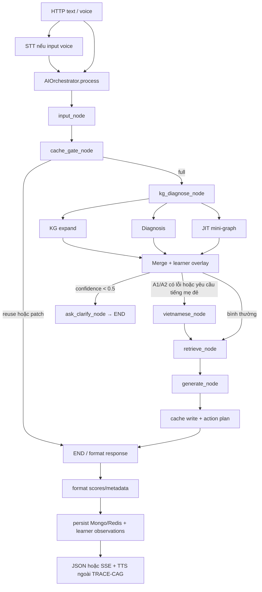
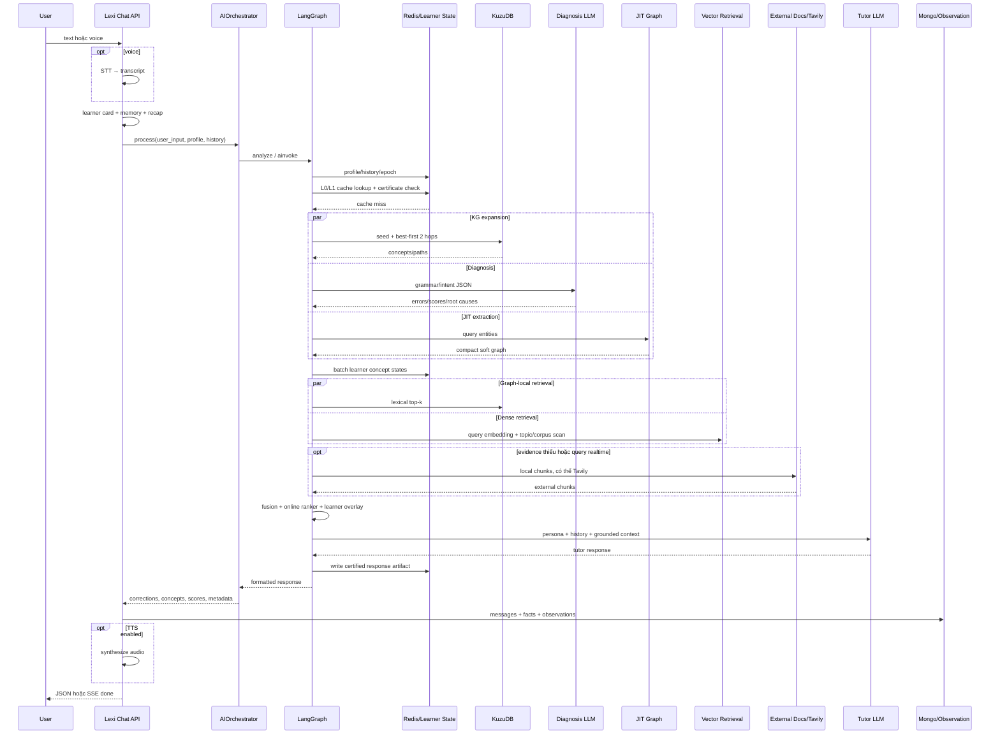

# TRACE-CAG Pipeline — từ input đến output

> Tài liệu đọc mã nguồn tại snapshot ngày 2026-11-10. Mục tiêu của tài liệu là mô tả implementation đang chạy, không chỉ mô tả kiến trúc trong README. Các tham chiếu `[S…]` trỏ tới mã nguồn ở cuối tài liệu.

## 1. Tóm tắt điều hành

TRACE-CAG của LexiLingo là một pipeline gia sư tiếng Anh có trạng thái, được điều phối bằng LangGraph `StateGraph`. Pipeline kết hợp:

- cache câu trả lời có chứng chỉ trạng thái (`reuse | patch | full`);
- Knowledge Graph KuzuDB;
- chẩn đoán ngữ pháp và ý định bằng LLM, có rule fallback;
- JIT mini-graph trích xuất entity từ chính câu hỏi;
- truy hồi lai: lexical/TF-IDF, graph traversal, dense embedding, graph analytics, learner-state overlay và tài liệu ngoài;
- sinh câu trả lời được grounding bằng context đã truy hồi;
- đánh giá, cache-write, lưu hội thoại và phát observation cho learner state.

Luồng production chính:



Điểm quan trọng:

1. Cache hit kết thúc graph trước diagnosis/retrieval/generation.
2. Cache miss chạy KG expansion, diagnosis và JIT graph song song.
3. Production không có vector database chuyên dụng. Embedding concept được giữ trong RAM và cosine similarity được tính bằng NumPy.
4. KuzuDB là graph database và là nguồn topology tri thức chính.
5. TTS node có trong source nhưng không nằm trong graph production; caller Lexi Chat thực hiện TTS sau khi có text.
6. Benchmark QA đi qua cùng graph nhưng thay diagnosis/retrieval/generation bằng các nhánh riêng cho corpus, multi-hop và IRCoT.

## 2. Phạm vi và các entry point

### 2.1 Entry point sản phẩm: Lexi Chat

`POST /api/v1/lexi-chat/chat` và `/stream` nhận `LexiChatRequest`. Trước TRACE-CAG, lớp Lexi Chat thực hiện:

1. xác thực user/session và quota;
2. nếu `input_type == "voice"`, decode audio và gọi STT;
3. tải learner card, session recap và durable memory song song;
4. gọi `AIOrchestrator.process(...)` hoặc `pipeline.analyze_for_streaming(...)`;
5. sau pipeline: sanitize output, TTS, persist MongoDB/Redis và observation.

Luồng non-streaming ở `run_lexi_pipeline()` [S17]. Luồng SSE ở `stream_lexi_chat()` [S18].

### 2.2 Entry point tích hợp TRACE-CAG trực tiếp

Route `integration_trace_cag.py` nhận learner snapshot, exercise context và request id, sau đó đi qua portable `TraceCAGService`. Request-id cache ở đây là idempotency cache Redis TTL 600 giây; nó khác response cache L0/L1 của pipeline [S19].

### 2.3 Orchestrator và lifecycle

`AIOrchestrator` là facade production. Thứ tự khởi tạo:

1. KuzuDB và schema/seed;
2. ModelGateway;
3. compile LangGraph;
4. background warm-up `RetrievalServiceV3` và GLiNER JIT graph.

Retrieval warm-up chạy nền vì graph analytics + khoảng 15K concept embeddings có thể mất nhiều phút. Request đến sớm sẽ chờ singleton lock thay vì tạo lần hai [S16].

### 2.4 API cốt lõi của pipeline

```python
await TraceCAGPipeline.analyze(
    user_input,
    session_id,
    user_id=None,
    input_type="text",
    learner_profile=None,
    conversation_history=None,
    stt_final=None,
    cache_policy="on",
    retrieval_policy="full",
    diagnosis_policy="auto",
    generation_policy="auto",
    topic_system_prompt=None,
    benchmark_task=None,
    benchmark_context=None,
    benchmark_metadata=None,
    kg_seed_concepts=None,
    return_raw_state=False,
)
```

`analyze()` tạo state, inject history/seeds nếu caller đã tải sẵn, gọi `compiled.ainvoke()`, rồi format state thành response API [S1].

## 3. State truyền xuyên pipeline

`TraceCAGState` là `TypedDict(total=False)`. Các nhóm dữ liệu chính [S2]:

| Nhóm | Field tiêu biểu | Được tạo/cập nhật ở đâu |
|---|---|---|
| Input | `user_input`, `session_id`, `user_id`, `input_type` | caller / `create_initial_state` |
| Policies | `cache_policy`, `retrieval_policy`, `diagnosis_policy`, `generation_policy` | caller |
| Learner | `learner_profile`, `conversation_history`, `learner_concept_states`, `learner_state_epoch` | input node + learner-state client |
| KG | `kg_seed_concepts`, `kg_expanded_nodes`, `kg_paths` | KG expansion |
| Diagnosis | `diagnosis_intent`, `diagnosis_errors`, `diagnosis_root_causes`, scores | diagnosis |
| Retrieval | `vector_hits`, `retrieved_context`, `retrieval_trace`, `retrieval_meta` | retrieve node |
| JIT graph | `jit_soft_graph`, `jit_graph_meta` | JIT extractor |
| Generation | `tutor_response`, `native_hint`, `strategy`, `next_action`, `action_plan` | native/generate/clarify nodes |
| Cache | `cache_decision`, `cache_layer`, `reuse_risk`, `cache_gate_meta` | cache gate |
| Metrics | token usage, latency, `models_used`, `graph_update`, `path` | các node và formatter |

State ban đầu đặt default level B1, confidence 1.0, cache decision `full`, path `slow`, các collection rỗng [S2].

## 4. StateGraph và điều kiện định tuyến

Graph production được compile như sau [S1][S3]:

```text
input_node
  → cache_gate_node
      ├─ decision ∈ {reuse, patch} → END
      └─ full → kg_diagnose_node
                   ├─ confidence < 0.5 → ask_clarify_node → END
                   ├─ native request → vietnamese_node → retrieve_node
                   ├─ A1/A2 và có error → vietnamese_node → retrieve_node
                   └─ còn lại → retrieve_node
                                      → generate_node
                                      → END
```

Lưu ý:

- `kg_expand_node` và `diagnose_node` vẫn được đăng ký riêng nhưng graph chính gọi wrapper `kg_diagnose_node` để chạy đồng thời.
- `tts_node` và các edge TTS tồn tại trong source nhưng không được add vào graph hiện tại.
- `ask_clarify_node` tạo câu trả lời hoàn chỉnh và kết thúc, không retrieval/generation tiếp.

## 5. Bước 0 — tiền xử lý ngoài TRACE-CAG

### 5.1 Text input

`request.message` trở thành `user_input`.

### 5.2 Voice input

Lexi Chat chạy STT trước khi gọi TRACE-CAG. Transcript thành `user_input`; TRACE-CAG chỉ thấy text và metadata `input_type/stt_final`. Vì vậy `route_voice_or_text()` hiện luôn đi tới cache gate [S3][S17].

### 5.3 Learner context ngoài pipeline

Lexi Chat tải song song:

- learner card/profile;
- các fact phù hợp với câu hỏi;
- session recap nếu là hội thoại mới;
- durable memory.

Các dữ liệu này được merge vào `learner_profile`. Nếu câu trả lời chứa live personal facts/memory, caller tắt cache để tránh trả XP/streak/level cũ [S17].

## 6. Bước 1 — `input_node`

### 6.1 Mục tiêu

`input_node` nạp context còn thiếu và ghi dependency đầu tiên [S4]:

- Redis learner profile;
- Redis conversation history nếu caller chưa truyền;
- learner-state epoch từ backend service;
- phát hiện yêu cầu giải thích bằng tiếng mẹ đẻ;
- dependency token cho learner profile.

### 6.2 Thuật toán và concurrency

- Profile và history Redis chạy bằng `asyncio.gather`.
- Learner-state epoch chạy thành task song song với Redis.
- Redis budget mặc định `TRACECAG_INPUT_REDIS_BUDGET_MS=500`.
- Redis hỏng/timeout: pipeline tiếp tục với profile request/default và history rỗng.
- Learner-state epoch hỏng: đánh dấu degraded; personalized cache sẽ bị bypass để không reuse state cũ.

### 6.3 Merge rule

```python
learner_profile = {**cached_profile, **request_profile}
```

Profile từ request thắng Redis nếu trùng key. Nếu caller truyền history, node không đọc Redis history lần nữa.

### 6.4 Dependency tracking

Node tạo dependency:

```text
key        = learner:<user-or-anonymous>:profile
kind       = learner
version    = learner state epoch hoặc SHA-256 stable token của profile
provenance = learner-state hoặc request-profile
```

Dependency này được đưa vào cache certificate và reverse invalidation sau này [S4][S20].

## 7. Bước 2 — cache gate RAPID/SCAR-L1

### 7.1 Ý nghĩa các tầng

| Tầng | Lookup | Mục tiêu |
|---|---|---|
| L0 | exact response-cache key | cùng user scope + normalized query + level (+ benchmark mode) |
| L1 | graph/state bucket aliases | câu gần giống nhưng state/concept/relation tương thích |
| Full | không reuse | chạy toàn bộ reconstruction |

Redis là shared authority trong production; in-process LRU chủ yếu là fallback benchmark/Redis-disabled [S5].

### 7.2 Điều kiện bypass cache

Cache trả `full` ngay nếu:

- `cache_policy != "on"`;
- user có learner-state nhưng epoch unavailable;
- không tạo được HMAC user scope do thiếu secret;
- request anonymous/không có user scope.

Điều này có nghĩa response cache production là personalized, không dùng global anonymous cache [S5].

### 7.3 Cache key và privacy scope

```text
user_scope = HMAC-SHA256(secret, user_id)[:24]
L0 key     = MD5(user_scope || normalized_input || CEFR_level || benchmark_mode?)
```

Raw user id không nằm trong key. L1 bucket còn chứa intent, profile epoch, conversation-turn bucket và concept/entity/relation hints [S5].

### 7.4 Cache certificate

Mỗi cached artifact lưu `CacheAdmissibilityCertificate` schema v4, gồm:

- normalized query, intent, CEFR, native language;
- HMAC user scope và profile epoch;
- policy version, KG schema/content dependencies;
- concepts, answer target, relation path;
- evidence/source/freshness hashes khi có;
- dependency trace;
- patchable slots;
- factual projection hash và provenance projection hash.

Hard gates kiểm tra user scope, schema, required dimensions, level, language, profile epoch, intent, target, versions, relation path, concept overlap và TTL [S6].

### 7.5 SCAR risk score

Sau hard gates, L1 tính:

```text
ρ = 0.20 × intent_drift
  + 0.30 × (1 − concept_jaccard)
  + 0.15 × (1 − relation_jaccard)
  + 0.20 × evidence_drift
  + 0.15 × max(age_ratio, version_drift)
```

Mặc định:

```text
τ_reuse = 0.25
τ_patch = 0.55
concept_floor = 0.50
```

Decision:

- normalized query giống và `ρ <= τ_reuse` → `reuse`;
- state-compatible near hit và `ρ <= τ_patch` → `patch`;
- còn lại → `full`.

Adaptive controller có thể thay các threshold trong benchmark/adaptive mode [S6][S24].

### 7.6 Patch thực sự làm gì?

Patch chỉ được phép trên slot được certificate khai báo. Implementation hiện có hai biến đổi nhẹ:

- thay marker CEFR `(B1)` → `(B2)` nếu level đổi;
- append `(Also related: ...)` cho concept mới, nhưng lọc token lexical nội bộ.

Sau patch, factual projection và retrieval provenance bắt buộc giữ nguyên hash. Production certificate thường không khai báo patchable slot nếu caller không cung cấp hints, nên `patch` thực tế bị giới hạn mạnh [S5].

### 7.7 Cache hit output

Cache hit phục hồi:

- `tutor_response`;
- retrieval trace;
- strategy;
- diagnosis errors và scores;
- action plan.

Nó đặt `path="fast"`, `ttft_ms=1`, `models_used=rapid_reuse_*` hoặc `rapid_patch_*`, sau đó graph đi thẳng tới END [S5].

### 7.8 Invalidation

Cache entry ghi dependency reverse edges. Khi KG/profile/policy mutation phát version mới, hệ thống tìm đúng artifact phụ thuộc và evict thay vì clear toàn bộ cache [S20]. Trước khi serve, dependency snapshot được recheck để chặn mutation xảy ra giữa lúc lookup và trả response.

## 8. Bước 3 — `kg_diagnose_node`: ba nhánh song song

Khi cache miss, wrapper chạy:

```python
await asyncio.gather(
    kg_expand_node(state),
    diagnose_node(state),
    _jit_graph_extract_node(state),
)
```

Sau merge, nó batch-load learner state cho tối đa 60 concept được chọn [S4]. Latency lý tưởng là `max(KG, diagnosis, JIT)` thay vì tổng ba nhánh.

## 9. Nhánh 3A — Knowledge Graph expansion

### 9.1 Nguồn graph

KuzuDB schema chính [S9]:

```text
Concept(id, title, keywords, level)
User(id)
Edge(Concept → Concept, relation)
Mastery(User → Concept, score)
```

Nguồn seed/sync:

- `ai-service/data/kg/seed_graph.json`;
- `ai-service/data/knowledge_extended.json` nếu có;
- các file runtime trong `ai-service/data/kg/*.json` được allowlist.

Production cấm namespace `concept:benchmark.*` trộn vào runtime KG.

### 9.2 Seed concept matching

`collect_seed_concepts()` ghép ba nguồn theo thứ tự [S4]:

1. semantic TF-IDF seeds, top 5;
2. exact/keyword IDF seeds;
3. regex grammar/topic patterns.

Deduplicate nhưng giữ thứ tự.

#### Semantic TF-IDF seed

Khi warm-up, service tạo TF-IDF vector sparse từ `title + keywords`. Query chỉ duyệt posting list của token xuất hiện, thay vì scan toàn bộ concept. Cosine sparse > `0.05`, lấy top-k [S9].

#### Keyword/IDF seed

Inverted index tính:

```text
idf(token) = log((N + 1) / (df + 1)) + 1
score       = matched_idf / total_query_idf × CEFR_boost
```

`CEFR_boost`:

- cùng level: `1.0`;
- lệch một level: `0.8`;
- xa hơn: `0.6`.

Nếu toàn bộ title token nằm trong query, score được nhân title-match boost [S9].

#### Regex seed

Các pattern bắt lỗi phổ biến như subject–verb agreement, tense, article, preposition, word order, modal, conditional; đồng thời nhận diện topic như social media, transport, emotion, job interview [S4].

### 9.3 Best-first graph traversal

Nếu KG expansion bật, pipeline gọi:

```text
max_hops  = 2
max_nodes = 10
```

Priority queue dùng PedWeight theo khoảng cách CEFR [S10]:

```text
same level  → 1.0
±1 level    → 0.7
khác        → 0.3
```

Low-value relation bị giảm trọng số. Nếu mastery traversal bật:

```text
weight *= 1 + β × (1 − 2 × mastery)
```

Concept yếu được ưu tiên, concept đã master bị giảm. Mỗi node query tối đa 50 outgoing edges; traversal dừng ở hop/node budget.

Shared, non-personalized traversal được cache Redis 30 phút bằng SHA-1 của seeds + level + budgets. Personalized mastery traversal không dùng shared cache [S10].

### 9.4 Output KG branch

```text
kg_seed_concepts
kg_expanded_nodes[{id, relation, title, keywords}]
kg_paths[{from_id, to_id, hops}]
graph_update
dependency kg:tracecag:main = KG content version
```

Nếu KG disabled hoặc lỗi, branch degrade thành list rỗng; không làm hỏng toàn turn.

## 10. Nhánh 3B — diagnosis

### 10.1 Nhiệm vụ

Diagnosis trả:

- tối đa 2 lỗi quan trọng;
- intent `correct | explain | practice | ask`;
- fluency, grammar, confidence;
- learner facts được user tự khai;
- root-cause concept IDs;
- vocabulary CEFR estimate.

### 10.2 Benchmark bypass

Với `benchmark_task ∈ {multihop_qa, retrieval_qa}`, diagnosis được bypass: intent `ask`, không error, confidence/grammar/fluency = 1.0 [S4].

### 10.3 Rule-forced mode

Nếu `diagnosis_policy="rules"`, dùng regex rules; không gọi LLM. Đây cũng là degraded retry mode của Lexi Chat [S4][S17].

### 10.4 LLM diagnosis chain

Thứ tự:

1. local Qwen qua ModelGateway;
2. Groq model diagnose, temperature 0, max 400 tokens;
3. rule-based fallback.

Prompt yêu cầu JSON. Parser:

- regex lấy object JSON trong output;
- chỉ giữ error span thực sự xuất hiện trong câu user;
- tối đa 2 errors;
- sanitize self-stated facts;
- map label về concept root cause.

`KG_DIAGNOSIS_BRIDGE`:

- `off`: legacy free-text label mapping;
- `map`: normalize/mapping vào 24 closed labels;
- `closed`: prompt bắt buộc đúng label set và đếm invalid label.

### 10.5 Vocabulary estimate

`EvaluationAgent` kiểm tra marker words từ C2 xuống B1; nếu không match thì dùng average word length, cuối cùng default B1 [S15]. Đây là heuristic, không phải một CEFR classifier học máy.

## 11. Nhánh 3C — JIT mini-graph

JIT graph là graph mềm được xây ngay từ câu hiện tại, độc lập với KuzuDB [S14].

Thuật toán:

1. GLiNER trích entity với labels person, organization, location, event, product, technology, date, time.
2. Nếu GLiNER không có/lỗi, regex lấy capitalized entity.
3. Deduplicate, cắt theo `max_nodes`.
4. Nối các entity kề nhau thành directed edges.
5. Quan hệ là text giữa hai entity nếu có preposition và đủ ngắn; nếu không là `related_to/contextual_link`.
6. Serialize JSON compact, cắt edge trước rồi node để nằm trong `max_chars`.
7. Cache in-process LRU theo normalized query và TTL.

Payload này được prepend vào `retrieved_context` dưới marker `[JIT_SOFT_GRAPH]`. Nếu feature flag tắt hoặc extractor lỗi, payload rỗng và pipeline tiếp tục.

## 12. Learner-state overlay

Sau ba nhánh, hệ thống lấy state cho tối đa 60 concept từ learner-state service. Nó chứa mastery, error count, stability, last interaction… [S4].

Trong retrieval, candidate score cá nhân hóa là [S13]:

```text
forgetting_risk = 1 − exp(−elapsed_days / stability_days)

learner_score = 0.50 × relevance
              + 0.25 × (1 − mastery)
              + 0.15 × forgetting_risk
              + 0.10 × recent_error
              − 0.20 × (1 − prerequisite_readiness)
```

Candidate concept yếu/sắp quên được ưu tiên. Nếu learner-state unavailable, pipeline dùng prior mastery 0.5 hoặc bỏ personalized traversal tùy mode.

## 13. Bước 4 — routing sau diagnosis

```text
confidence < 0.5
  → ask_clarify_node

explicit native-language request
  → vietnamese_node

level ∈ {A1, A2} và có error
  → vietnamese_node

còn lại
  → retrieve_node
```

### 13.1 Clarify branch

Clarify dùng ModelGateway chat tạo câu hỏi ngắn để user chọn correction/explanation/practice. Nếu lỗi, dùng fixed English text. Đồng thời có native hint theo Vietnamese/Japanese/Korean/Chinese. Branch đặt `strategy=ask`, `path=fast` và kết thúc graph [S4].

### 13.2 Native hint branch

Thứ tự:

1. Qwen qua ModelGateway;
2. Gemini fallback;
3. predefined localized strings.

Hint chỉ bổ sung; câu trả lời chính vẫn được tạo ở `generate_node`. Sau node này pipeline luôn đi retrieval [S4].

## 14. Bước 5 — hybrid retrieval

`retrieve_node` thực hiện các stage sau [S7].

### 14.1 Budget mặc định

```text
KG stage     120 ms
vector stage  80 ms
fusion stage  40 ms
```

Các giá trị lấy từ env. Vector task được start trước stage graph-local để chạy đồng thời. Khi await, timeout là phần còn lại của vector budget tính từ đầu retrieve; quá hạn thì cancel và bỏ toàn bộ vector result.

### 14.2 Stage 1 — graph-local evidence

Candidate nguồn:

- diagnosis root causes, depth 0;
- expanded KG nodes;
- `query_concepts()` top-k mặc định 8;
- diagnosis error/correction snippets.

KG query top-k có in-process LRU TTL mặc định 900 giây, max 200 entries. Node được pack theo token budget gần đúng, mặc định 160 tokens [S7][S8].

### 14.3 Stage 2 — dense concept retrieval

`RetrievalServiceV3` warm concept embeddings vào:

```python
Dict[concept_id, np.ndarray]
```

Không có Qdrant/FAISS/Chroma/Pinecone ở đường production này [S11].

Embedding chain [S12]:

1. Gemini `text-embedding-004` nếu `TRACECAG_PREFER_CLOUD_LLM=true` và có key;
2. local `sentence-transformers/all-MiniLM-L6-v2`;
3. deterministic 384-d hash embedding fallback.

Tất cả vector được L2-normalize; cosine similarity là dot product.

#### Topic routing

Query được embed một lần. Matrix multiply với embedding các `topic:*` node:

```text
best similarity >= 0.40 → route top 2 topics
```

Nếu route được, retrieval chỉ scan members của topic subgraph và bỏ centrality/community pruning để không làm loãng topic [S11].

#### Corpus-wide vector path

Nếu không route topic:

1. Kuzu expansion 1 hop từ seeds;
2. scan embedding của tất cả concept;
3. lọc similarity `< 0.3`;
4. giữ vector top 10;
5. centrality rerank;
6. community diversity prune còn tối đa 5.

Dense similarity:

```text
sim(q, c) = dot(normalize(E(q)), normalize(E(c)))
```

#### Graph analytics rerank

NetworkX tính [S11]:

```text
centrality = 0.3 × degree
           + 0.3 × betweenness
           + 0.4 × PageRank

retrieval_score = 0.7 × semantic
                + 0.3 × analytics_score
```

Betweenness sampling tối đa 500 node trên graph lớn. Comment nói “Louvain”, nhưng implementation community detection thực tế dùng `greedy_modularity_communities`; trên graph >3000 node nó bỏ clustering và gán mỗi node một community riêng [S11].

#### Dense fallback

Nếu `RetrievalServiceV3` lỗi, node gọi ModelGateway MiniLM similarity trên labels của seed/expanded concepts. Threshold mặc định 0.3; rapid/confident có thể 0.35 [S7].

### 14.4 Stage 3 — external document/Web L2

Kích hoạt khi:

- evidence hiện có `< 3`; hoặc
- query có từ thời gian thực như `latest`, `today`, `news`, `mới nhất`, `hôm nay`.

#### Local docs ingestion

`DocumentIntelligenceService` đọc `.md/.txt` từ relative path `data/external_docs` [S21]. Chunking:

```text
split bằng hai newline
bỏ chunk < 40 ký tự
chunk_id = MD5(content)
embed từng chunk
giữ content/vector/source/hit_count trong list RAM
```

Không có overlap, tokenizer-aware chunk size, persistent vector index hay ANN index.

#### Local retrieval

```text
score = dot(query_vector, chunk_vector)
chỉ nhận score > 0.70
sort giảm dần
top_k = 3
```

#### Web fallback

Nếu local best score `< 0.65`, gọi Tavily, max 3 results. Web content được đưa qua cùng paragraph chunking rồi query lại. Nếu re-query vẫn rỗng, trả raw web content với score fallback `0.55` [S21].

Dynamic query ngắn được rewrite thành `latest information about <query>`. Toàn stage bị bọc timeout 5 giây [S7].

### 14.5 Fusion score

Candidate thường được chấm [S7]:

```text
s_kg  = 1 / (1 + graph_depth)
s_vec = cosine similarity
s_rec = exp(−0.01 × turns_ago)

fusion = 0.5 × s_kg
       + 0.3 × s_vec
       + 0.2 × s_rec
```

Nếu tổng retrieval budget đã quá hạn, candidate chưa có fusion score dùng `vec_sim` trực tiếp.

### 14.6 Online pairwise ranker

Sau static fusion, optional online ranker dùng pairwise logistic learning [S13]. Feature gồm:

- base/fusion score;
- body/title lexical overlap;
- anchor coverage/title phrase/title recall;
- KG proximity;
- vector, graph, memory, recency signals;
- external evidence penalty.

Scoring là sigmoid của linear combination; adaptive mode thêm exploration bonus kiểu UCB:

```text
bonus = exploration × sqrt(log(total_updates + 2) / (item_seen + 1))
```

Sau generation, response support tạo weak labels để update cặp positive/negative bằng logistic gradient + L2 penalty.

### 14.7 Evidence budget và context assembly

Production mặc định:

```text
base budget = 5
max budget  = 9
```

Question complexity tăng budget; rapid mode có thể giảm 1, trừ multi-hop. Benchmark arm có declared budget thì giá trị đó thắng hoàn toàn [S24].

Top evidence được ghi thành `retrieval_trace` gồm id/title/text/rank/score. Context cuối:

```text
retrieved_context = join(top_evidence.text, "\n")
```

Nếu có JIT soft graph, prepend:

```text
[JIT_SOFT_GRAPH]
<compact JSON>

<retrieved evidence>
```

Retrieval tạo `evidence_version`, `source_version` và dependency record phục vụ cache certificate [S7].

## 15. Bước 6 — grounded generation

### 15.1 Chọn strategy

```text
intent == explain và fluency > 0.7 → socratic
không error                         → praise
1–2 errors                         → feedback
>2 errors                          → scaffold
```

Diagnosis prompt hiện giới hạn tối đa 2 lỗi, nên `scaffold` chủ yếu có ý nghĩa với state từ nguồn khác/legacy [S22].

### 15.2 Difficulty ramp

```text
turn < 3 hoặc previous overall < 0.50 → gentle
turn < 8 hoặc previous overall < 0.70 → standard
còn lại                              → challenging
```

### 15.3 Prompt assembly

System prompt gồm:

1. topic-specific prompt hoặc persona Lexi;
2. learner CEFR + difficulty;
3. profile facts, goal, interest, memory, session recap;
4. persistent weak-concept hint;
5. `Knowledge Graph Context` — tên này chứa toàn bộ KG/vector/external/JIT context;
6. strategy/correction directive;
7. native-language hint;
8. tối đa 12 history messages;
9. current user input.

Nếu user hỏi một câu, prompt bắt buộc trả lời trước rồi mới correction. Nếu user không hỏi và không lỗi, prompt yêu cầu phản hồi như conversation partner, không chấm điểm [S22].

### 15.4 Generation policies

| Policy | Hành vi |
|---|---|
| `auto` | LLM provider chain |
| `extractive` | deterministic/extractive fallback, không gọi tutor LLM |
| `template` | deprecated alias của `extractive` |
| `skip` | graph chuẩn bị raw state; SSE caller tự stream LLM |

### 15.5 Provider selection thực tế

Non-streaming production [S22]:

1. optional local llama.cpp KV path nếu flag bật;
2. Groq và Gemini được launch đồng thời;
3. response thành công đầu tiên thắng, task còn lại bị cancel;
4. nếu cả hai fail, Ollama timeout 15 giây;
5. cuối cùng `SAFE_TUTOR_FALLBACK`.

Vì vậy docstring “Groq → Gemini → Ollama” không hoàn toàn chính xác: Groq/Gemini là race, không phải tuần tự.

LLM client dùng persistent HTTP/2 clients, RPM/TPM pacing, per-key lock, retry 429 và provider cooldown [S23]. Qwen trên Groq được đặt `reasoning_effort="none"` cho production structured/concise output.

### 15.6 Next action và overall score

```text
socratic → ask
0 error  → continue
1–2      → hint
>2       → correct
```

Overall score [S15]:

```text
overall = 0.40 × grammar
        + 0.30 × fluency
        + 0.30 × CEFR_vocab_numeric
```

CEFR numeric: A1=.10, A2=.25, B1=.45, B2=.65, C1=.85, C2=1.0.

### 15.7 Action plan

Nếu có errors hoặc intent practice, `ContentAutoGenerator` tạo grammar drill hoặc vocabulary exercise, rồi gắn vào `action_plan`. Service `cag_service.py` này là content auto-generation; nó không phải core TRACE-CAG retrieval engine [S22].

### 15.8 Cache write

Sau response hợp lệ:

- KG/rule flow: ghi structured response entry mặc định;
- external L2 flow: chỉ ghi khi external chunk `hit_count >= 3`;
- safe fallback không cache.

TTL:

```text
có diagnosis errors → 3600 giây
không errors        → 1800 giây
```

Điểm cần hiểu đúng: “promote external chunk to L1” trong log không tạo một Redis vector knowledge store riêng. Code gọi `_write_cache_entry()` để cache toàn bộ response artifact gắn với evidence [S5][S22].

## 16. Bước 7 — format output

`_format_response()` recompute các metric để cache-hit và slow-path có schema nhất quán [S1].

### 16.1 Response chính

```json
{
  "tutor_response": "...",
  "corrections": [
    {
      "error": "...",
      "correction": "...",
      "type": "...",
      "explanation": "..."
    }
  ],
  "linked_concepts": ["..."],
  "weak_concepts": ["..."],
  "action_plan": [],
  "native_hint": null,
  "pronunciation_tip": null,
  "scores": {},
  "action": {},
  "metadata": {},
  "audio": null
}
```

### 16.2 Text quality metrics

- WER bằng word-level Levenshtein giữa input và corrected text;
- correction count;
- errors per 100 words;
- type-token ratio.

### 16.3 Retrieval metrics

Chỉ có ý nghĩa khi benchmark gắn `is_relevant`:

- Precision@K;
- Recall@K;
- NDCG@K;
- MRR.

Production thường trả các giá trị retrieval metric `null` vì không có gold relevance [S15].

### 16.4 Metadata vận hành

Bao gồm latency, TTFT, models, path, cache hit/decision/layer/risk, adaptive profile, tokens saved, diagnosis intent, số KG node, retrieval trace/meta và graph update.

## 17. Bước 8 — hậu xử lý ngoài graph

Lexi Chat tiếp tục [S17]:

1. sanitize response và ngôn ngữ;
2. optional TTS;
3. lưu user + assistant messages vào MongoDB;
4. update session store;
5. append ConversationCache Redis;
6. lưu self-stated facts;
7. persist learner observations qua durable spool;
8. trả `LexiChatResponse`.

Nếu primary pipeline raise exception, caller retry với:

```text
cache_policy      = off
retrieval_policy  = rapid
diagnosis_policy  = rules
generation_policy = auto
conversation_history = []
```

Nếu retry cũng fail, trả safe fixed response [S17].

## 18. Streaming SSE khác non-streaming thế nào?

Streaming không stream trực tiếp toàn bộ LangGraph [S18]:

1. gửi `thinking`, sau đó heartbeat;
2. gọi `analyze_for_streaming(generation_policy="skip")` để chuẩn bị cache/KG/diagnosis/retrieval;
3. cache hit: chia cached response thành word chunks;
4. cache miss: `build_generation_prompt()` rồi `stream_llm_tokens()`;
5. provider token được buffer đầy đủ, sanitize, sau đó mới emit word chunks để marker nội bộ không lọt ra;
6. tự update online ranker và write cache;
7. TTS sau text chunks;
8. persist và gửi `done` event.

Event contract:

```text
thinking → heartbeat* → chunk* → done
                         └──────→ error nếu unrecoverable
```

Tên “stream token” vì vậy cần hiểu là provider có stream, nhưng client nhận word chunks sau khi response đã được buffer và sanitize.

## 19. Benchmark/public-QA branch

Nhánh benchmark tái sử dụng StateGraph nhưng thay đổi dữ liệu và thuật toán ở diagnosis, retrieval và generation.

### 19.1 Corpus construction

Mỗi distinct `(title, text)` passage trong dataset là một document. Không chunk tiếp theo token. Embedding corpus cache thành `.npy` theo content-derived corpus version [S25].

### 19.2 Shared hybrid retriever

```text
BM25(title + text)
       +
MiniLM dense similarity
       ↓
Reciprocal Rank Fusion, k=60
       ↓
top 50
       ↓
CrossEncoder ms-marco-MiniLM-L-6-v2
       ↓
top-k shortlist
```

Dense search vẫn là NumPy matrix multiplication, không phải vector DB [S25].

### 19.3 Candidate ranking trong TRACE-CAG

Benchmark candidate có lexical features, query anchors, candidate bridge graph và 2 vòng memory propagation [S24]:

- edge 1.0 nếu title B xuất hiện nguyên văn trong body A;
- edge 0.4 nếu title-token overlap đạt threshold;
- seed là top-2 lexical candidate;
- graph score = `0.7 × seed_bridge + 0.3 × degree`;
- memory propagation dùng `0.15` self-retention và `0.85` truyền qua outgoing edges, chạy 2 vòng.

Graph-ranker final score cộng base lexical, graph, memory, query coverage và title/anchor features. Multi-hop selector cố chọn evidence đa dạng/đủ coverage.

### 19.4 IRCoT

IRCoT chỉ dùng benchmark multi-hop, không dùng production chat [S26]. Mỗi round:

1. LLM đọc question + current passages và xuất một bridge entity;
2. search bridge entity trong full corpus hoặc candidate pool;
3. kiểm tra bridge contract: entity có anchor ở question/base context và passage mới có title/content match;
4. prepend bridge passages;
5. reader trả lời trên context augmented;
6. có thể lặp thêm round nếu arm khai báo.

### 19.5 Benchmark reader

- context được cắt theo arm-declared window;
- optional IRCoT augmentation;
- provider reader sinh short answer;
- postprocess loại prose/thinking và ép answer granularity;
- grounding/quality gate quyết định cache eligibility;
- usage ledger ghi mọi provider call.

## 20. Các cache khác nhau trong hệ thống

| Cache | Key/Scope | Dữ liệu | TTL/giới hạn |
|---|---|---|---|
| External request cache | request id | idempotent API response | 600s |
| Conversation cache | session | chat turns | Redis policy riêng |
| L0 response cache | user HMAC + exact query + level | full response artifact | 30–60 phút |
| L1 bucket cache | user + state/concept/entity/relation | near-hit response candidates | cùng entry TTL |
| KG subgraph cache | seed set + CEFR + traversal budget | expanded nodes/paths | 30 phút |
| KG top-k query cache | query + level + top-k | lexical concept hits | mặc định 900s |
| JIT graph cache | normalized query | compact soft graph | env-configurable LRU/TTL |
| Concept embedding cache | process singleton | NumPy vectors | process lifetime |
| External docs index | process singleton | chunks + vectors + hit count | process lifetime |
| Benchmark embedding cache | corpus version + model | `.npy` matrix | persistent file |

## 21. Failure/degradation matrix

| Failure | Hành vi |
|---|---|
| Redis profile/history | tiếp tục với request/default context |
| learner-state epoch unavailable | personalized cache bypass |
| KuzuDB/KG expansion lỗi | empty KG result |
| local diagnosis model lỗi | Groq, rồi regex rules |
| JIT GLiNER lỗi | capitalized-entity regex hoặc empty graph |
| RetrievalServiceV3 lỗi | MiniLM gateway fallback |
| vector stage timeout | cancel và dùng graph/local evidence |
| Tavily thiếu key/lỗi | bỏ external evidence |
| Groq tutor lỗi | Gemini race/remaining result |
| Groq + Gemini lỗi | Ollama |
| mọi tutor model lỗi | safe tutor fallback, không cache |
| clarify/native model lỗi | predefined/fixed response |
| primary Lexi pipeline raise | degraded retry |
| degraded retry raise | safe fixed response |
| TTS lỗi | text response vẫn trả bình thường |

## 22. Cấu hình quan trọng

### Core feature flags

| Setting/env | Default trong code | Ý nghĩa |
|---|---:|---|
| `KG_ENABLED` | true | bật Kuzu KG |
| `KG_EXPANSION_ENABLED` | true | bật best-first expansion |
| `KG_MASTERY_TRAVERSAL` | false | mastery-aware traversal |
| `KG_DIAGNOSIS_BRIDGE` | off | `off | map | closed` |
| `LEARNER_STATE_MODE` | off | `off | shadow | read | primary` |
| `LEARNER_STATE_DEADLINE_MS` | 40 | learner-state request budget |
| `EMBEDDING_MODEL` | MiniLM-L6-v2 | local embedding model |
| `TRACECAG_ENABLE_JIT_MINIGRAPH` | env | bật JIT graph |
| `TRACECAG_ENABLE_LOCAL_LLAMA_KV` | false | local KV generation path |

### Retrieval/cache defaults

| Env | Default |
|---|---:|
| `TRACECAG_PCC_TAU_REUSE` | 0.25 |
| `TRACECAG_PCC_TAU_PATCH` | 0.55 |
| `TRACECAG_KG_TOPK` | 8 |
| `TRACECAG_KG_CONTEXT_TOKEN_BUDGET` | 160 |
| `TRACECAG_KG_QUERY_CACHE_TTL_SECONDS` | 900 |
| `TRACECAG_RETRIEVE_BUDGET_KG_MS` | 120 |
| `TRACECAG_RETRIEVE_BUDGET_VECTOR_MS` | 80 |
| `TRACECAG_RETRIEVE_BUDGET_FUSION_MS` | 40 |
| `TRACECAG_EVIDENCE_BUDGET_BASE` | 5 |
| `TRACECAG_EVIDENCE_BUDGET_MAX` | 9 |

## 23. Những điểm dễ hiểu nhầm hoặc cần lưu ý

### 23.1 Không có vector DB production

Có vector embeddings và dense search, nhưng index là dict/matrix NumPy trong process. KuzuDB là graph DB. Benchmark lưu matrix `.npy`. Không thấy Qdrant, Pinecone, Chroma, Weaviate, Milvus, pgvector hay FAISS trong dependency/runtime hiện tại.

### 23.2 “Knowledge Graph Context” là tên rộng

Prompt section này có thể chứa diagnosis, KG, dense concept hits, external web chunks và JIT soft graph; không phải tất cả dòng đều xuất phát từ KuzuDB.

### 23.3 Community algorithm comment lệch code

Docstring nói Louvain nhưng code gọi NetworkX greedy modularity; graph lớn hơn 3000 node thì community detection bị skip.

### 23.4 Provider chain comment lệch code

Non-streaming thực tế race Groq và Gemini. Streaming thử Groq stream rồi Gemini fallback theo implementation của generator.

### 23.5 External “promotion” là response caching

Chunk có hit count cao làm toàn response đủ điều kiện cache; chunk vector không được chuyển sang một Redis vector index riêng.

### 23.6 Relative external-doc path

`DocumentIntelligenceService` dùng `data/external_docs` tương đối theo current working directory. Nếu service không chạy từ `ai-service/`, local docs có thể không được load.

### 23.7 Nominal retrieval budget không bao trùm toàn bộ external stage

KG/vector/fusion có budget riêng, nhưng external L2 dùng timeout 5 giây. Do đó latency thực tế của retrieve có thể lớn hơn tổng 240 ms nominal.

### 23.8 TTS không nằm trong StateGraph production

`tts_node` tồn tại nhưng graph không nối tới nó. Lexi Chat caller thực hiện TTS sau output text.

## 24. Sequence chi tiết của một turn production cache miss



## 25. Bản đồ file theo trách nhiệm

| File | Trách nhiệm |
|---|---|
| `trace_cag/graph.py` | compile graph, analyze, format response |
| `trace_cag/state.py` | state schema và defaults |
| `trace_cag/edges.py` | conditional routing |
| `trace_cag/nodes_v2.py` | input, KG, diagnosis, JIT wrapper, native, clarify |
| `trace_cag/cache_utils.py` | L0/L1 read/write, certificate, bucket, patch |
| `trace_cag/l1_state_cache.py` | pure SCAR decision/risk |
| `trace_cag/dependencies.py` | dependency/version tokens |
| `trace_cag/invalidation.py` | reverse invalidation |
| `trace_cag/retrieve.py` | evidence collection/fusion/context |
| `trace_cag/retrieval_ranker.py` | online pairwise ranker |
| `trace_cag/generate.py` | prompts, provider chain, response/cache/action plan |
| `trace_cag/llm_client.py` | HTTP pool, RPM/TPM, retry/cooldown |
| `trace_cag/evaluation_agent.py` | CEFR/overall/text/retrieval metrics |
| `trace_cag/benchmark/*` | adaptive, ranking, QA/IRCoT, quality gates |
| `kg_service_v3.py` | Kuzu schema, seed/index, graph traversal |
| `retrieval_service_v3.py` | dense retrieval + graph analytics rerank |
| `embedding_service_v3.py` | Gemini/MiniLM/hash embeddings |
| `graph_analytics.py` | centrality/community calculations |
| `document_intelligence.py` | local docs + Tavily L2 |
| `jit_graph_service.py` | GLiNER/fallback query mini-graph |
| `learner_overlay.py` | personalized mastery/forgetting rerank |
| `orchestrator.py` | lifecycle + public facade |
| `lexi_chat_service.py` | STT, context, call pipeline, stream, persist, TTS |

## 26. Kết luận kiến trúc

TRACE-CAG production là một **cache-first, graph-grounded, hybrid-retrieval tutor pipeline**. “CAG” ở đây không chỉ là nhét toàn bộ document vào context. Fast path tái sử dụng response artifact khi state certificate an toàn; slow path reconstruct context từ learner state + Kuzu topology + lexical/dense evidence + optional external knowledge, rồi mới sinh câu trả lời.

Mô hình lưu trữ hiện tại:

```text
KuzuDB             → topology/concepts
Redis              → profiles, conversations, response artifacts, subgraph cache
PostgreSQL/backend → durable learner concept state
MongoDB            → chat/session persistence
NumPy RAM          → concept/external-doc embeddings
.npy files         → benchmark corpus embeddings
```

Đặc trưng nổi bật nhất không phải vector database mà là sự kết hợp của:

1. certified cache reuse;
2. CEFR/mastery-aware graph expansion;
3. multi-signal evidence fusion;
4. learner-state personalization;
5. graceful degradation ở gần như mọi external dependency.

## 27. Nguồn mã đã đối chiếu

- **[S1]** `ai-service/api/services/trace_cag/graph.py:40-421` — StateGraph, analyze, formatter, streaming preparation.
- **[S2]** `ai-service/api/services/trace_cag/state.py:12-380` — state schema và initial state.
- **[S3]** `ai-service/api/services/trace_cag/edges.py:12-87` — routing predicates.
- **[S4]** `ai-service/api/services/trace_cag/nodes_v2.py:121-1305` — input, seeds, KG, diagnosis, concurrent wrapper, native/clarify/TTS.
- **[S5]** `ai-service/api/services/trace_cag/cache_utils.py:63-1558` — fingerprint, certificate, key/bucket, L0/L1, patch và write.
- **[S6]** `ai-service/api/services/trace_cag/l1_state_cache.py:14-200` — SCAR weights, hard gates và ternary decision.
- **[S7]** `ai-service/api/services/trace_cag/retrieve.py:53-705` — hybrid retrieval, external L2, fusion và context.
- **[S8]** `ai-service/api/services/trace_cag/kg_utils.py:31-85` — query cache và token-budget packing.
- **[S9]** `ai-service/api/services/kg_service_v3.py:242-665,1060-1127` — schema, sources, concept cache, TF-IDF và lexical top-k.
- **[S10]** `ai-service/api/services/kg_service_v3.py:703-856` — PedWeight best-first expansion và Redis subgraph cache.
- **[S11]** `ai-service/api/services/retrieval_service_v3.py:46-476`; `ai-service/api/services/graph_analytics.py:66-264` — vector retrieval, topic routing, centrality/community.
- **[S12]** `ai-service/api/services/embedding_service_v3.py:23-169` — embedding chain.
- **[S13]** `ai-service/api/services/trace_cag/retrieval_ranker.py:20-185`; `ai-service/api/services/learner_overlay.py:32-90` — online ranker và learner rerank.
- **[S14]** `ai-service/api/services/jit_graph_service.py:29-320` — JIT entity graph.
- **[S15]** `ai-service/api/services/trace_cag/evaluation_agent.py:15-347` — CEFR, scoring và metrics.
- **[S16]** `ai-service/api/services/orchestrator.py:57-275` — lifecycle và public process facade.
- **[S17]** `ai-service/api/services/lexi_chat_service.py:527-847` — non-streaming product pipeline và persistence.
- **[S18]** `ai-service/api/services/lexi_chat_service.py:850-1140`; `ai-service/api/routes/lexi_chat.py:257-339` — SSE path.
- **[S19]** `ai-service/api/routes/integration_trace_cag.py`; `ai-service/api/services/trace_cag/external_request_cache.py:17-44` — integration API và idempotency.
- **[S20]** `ai-service/api/services/trace_cag/dependencies.py:18-84`; `ai-service/api/services/trace_cag/invalidation.py:32-124` — dependency certificates và invalidation.
- **[S21]** `ai-service/api/services/document_intelligence.py:17-157` — chunking/local/web document retrieval.
- **[S22]** `ai-service/api/services/trace_cag/generate.py:69-912` — personalization, prompt, generation, action plan và cache write.
- **[S23]** `ai-service/api/services/trace_cag/llm_client.py:37-285`; `provider_state.py:13-47` — provider pacing/retry state.
- **[S24]** `ai-service/api/services/trace_cag/benchmark/ranking.py:353-891`; `adaptive.py:28-305` — benchmark graph ranking, evidence budget, learned/adaptive controls.
- **[S25]** `ai-service/model-development/benchmark/tracecag_bench/corpus.py:33-260`; `runtime/ai_service.py:66-165` — corpus retriever và injection vào pipeline.
- **[S26]** `ai-service/api/services/trace_cag/benchmark/qa_generation.py:574-1373` — IRCoT, reader, postprocess và quality flow.

## 28. Khoảng trống cần kiểm chứng khi triển khai

- Giá trị env production có thể khác defaults trong tài liệu; cần dump config ở container để xác nhận feature nào đang bật.
- `data/external_docs` phụ thuộc working directory; cần xác nhận Docker `WORKDIR`.
- Hiệu quả của community rerank trên production graph lớn bị giới hạn vì community detection bị skip trên >3000 nodes.
- Patch path cần benchmark production riêng vì certificate thường không khai báo patchable slots.
- Embedding cloud/local phải đồng nhất dimension trong cùng process; code có fallback khi dot-product shape mismatch nhưng mismatch làm candidate score về 0.
- Online ranker là process-local, chưa thấy persistence weights qua restart.
